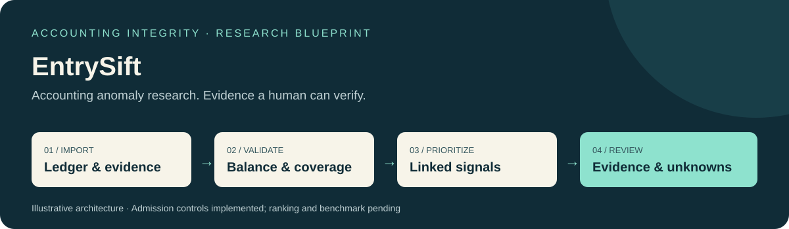
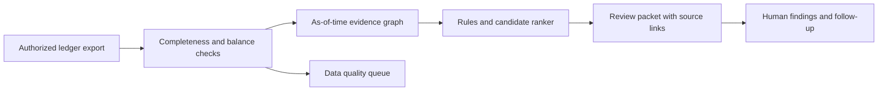

# Ledger Integrity Lab

[](https://github.com/vishwanathmuthuraman/Ledger-Integrity-Lab/actions/workflows/docs.yml)
[](https://github.com/vishwanathmuthuraman/Ledger-Integrity-Lab/actions/workflows/implementation.yml)

### From accounting entries to evidence a reviewer can inspect.



**Stage: initial offline implementation.** Runnable Python components, synthetic demos and behavioral tests are available. The complete workflow, predictive/model evaluation and production product remain pending. The initial code performs journal admission and accounting controls; the contextual detector remains unimplemented.

A proposed research system that identifies unusual journal entries and linked accounting patterns, then shows a finance reviewer **what changed, which records support the concern, and what evidence is missing**. An unusual entry is a reason to review; it is not proof of fraud.

| Research focus | Engineering approach | First deliverable |
|---|---|---|
| Management override indicators, period-end adjustments, reversal patterns and related-entity gaps | Python + SQL; exact money; reproducible time-aware evaluation | A local review queue compared with transparent baselines |

## Run the initial implementation

Install [uv](https://docs.astral.sh/uv/getting-started/installation/), then run these commands from this repository. The runtime is pinned to Python 3.12.13; dependencies are pinned in `uv.lock`.

```sh
uv sync --locked
uv run --locked ledger-lab inspect examples/normal-recurring.scenario.json
uv run --locked pytest
```

The CLI prints JSON. `validate` checks the same input contract; invalid or unsupported input returns exit code 2 with a JSON error on stderr. Successful inspection returns exit code 0.

**Verified locally:** 31 behavioral/CLI tests, Ruff checks, and an installed wheel executed outside the checkout. See [completed tasks and next steps](docs/IMPLEMENTATION.md), [the actual verification record](reports/initial-implementation/verification.json) and [captured demo output](reports/initial-implementation/demo-1.json). This evidence covers the initial offline components; the full study remains pending.

## The question

**Can linked journal-entry context improve recall at a fixed review budget without overwhelming reviewers with legitimate accruals, reversals and closing adjustments?**

This is the question to test, not a result already achieved. The contribution must come from documented experiments, defensible labels, faithful explanations and reproducible software—not a claim that anomaly detection itself is new.



## What makes this worth building

- **A balanced entry can still deserve review.** The planned detector evaluates business context after validating arithmetic.
- **Future knowledge must stay in the future.** A reversal or document received tomorrow cannot improve yesterday's score.
- **Legitimate exceptions matter.** Approved closing entries and documented recurring reversals are deliberate hard negatives.
- **Explanations must be verifiable.** Every reason links to the exact entry, available evidence, rule version and observation time.
- **Review effort is the scarce resource.** Evaluate useful cases found within a fixed number of reviews, not accuracy alone.

## What is here today

The folder includes eight design chapters, requirement and planned-test registers, strict JSON contracts, original synthetic scenarios with separate expected specifications, a source register, an experiment template, and runnable documentation tooling. Those scripts validate the public specification and authored fixture consistency; they do not run the proposed detection algorithm.

Read the standing [engineering policy](ENGINEERING.md) before implementation. Start with the [reading guide](START-HERE.md) and the design documents below.

| Read | Purpose |
|---|---|
| [Requirements](docs/01-product-requirements.md) | Users, boundaries, rules and observable acceptance behavior |
| [Architecture](docs/02-architecture.md) | Data flow, exact amounts, time visibility and algorithm choices |
| [Public milestones](docs/03-build-plan.md) | Observable engineering and evaluation gates |
| [Evaluation](docs/04-evaluation.md) | Baselines, entity/time splits, labels and review-budget metrics |
| [Definition of done](docs/05-definition-of-done.md) | Conditions for a research release and a supervised pilot |
| [Sources](docs/06-sources-and-design-rationale.md) | Primary references, design inferences and limitations |
| [Technical limitations](docs/07-delivery-and-risk.md) | Data, evaluation and interpretation risks |
| [Publication](docs/08-publication.md) | Public evidence versus private production material |

## How this differs from the finance reconciliation project

**Finance Exception Investigator** examines whether invoices, orders, payments and recorded amounts agree. **Ledger Integrity Lab** examines potentially concerning accounting behavior even when those records reconcile: unusual combinations of accounts, unsupported adjustments, timing, reversals, control exceptions and incomplete related-entity context. The projects can share permitted import contracts later; their questions and evaluations remain separate.

## Run the documentation checks

```sh
uv sync --locked
uv run --locked python scripts/validate_blueprint.py
uv run --locked python scripts/check_public_docs.py
```

The remaining workflow and evaluation are planned in the [public milestones](docs/03-build-plan.md). The documentation check record is [blueprint-validation.json](docs/blueprint-validation.json).

## Release boundary

This is the curated public research specification. Detailed delivery schedules and full internal handoffs are maintained separately. A future implemented release should publish enough software and experimental evidence to be independently assessed, using synthetic or properly licensed data. Customer exports, private production controls, live identifiers, raw interview notes and commercial strategy stay outside that edition. Public material can be copied; language choice does not prevent copying. License selection is pending.

No automatic changes to books, accusations, payment blocks, personnel decisions, investment recommendations or audit opinions are in scope.

## Public package

This edition includes original synthetic examples, contracts, evaluation methods, source rationale and public milestones. Internal task schedules and effort estimates are maintained outside the repository. Initial component source and verification are included; measured algorithm results remain pending. License selection is pending; no code, documentation or data license grant is supplied.

Maintained by [Vishwanath Muthuraman](https://github.com/vishwanathmuthuraman). [Contribution guidance](CONTRIBUTING.md) explains how to propose a synthetic case or challenge a design assumption.
