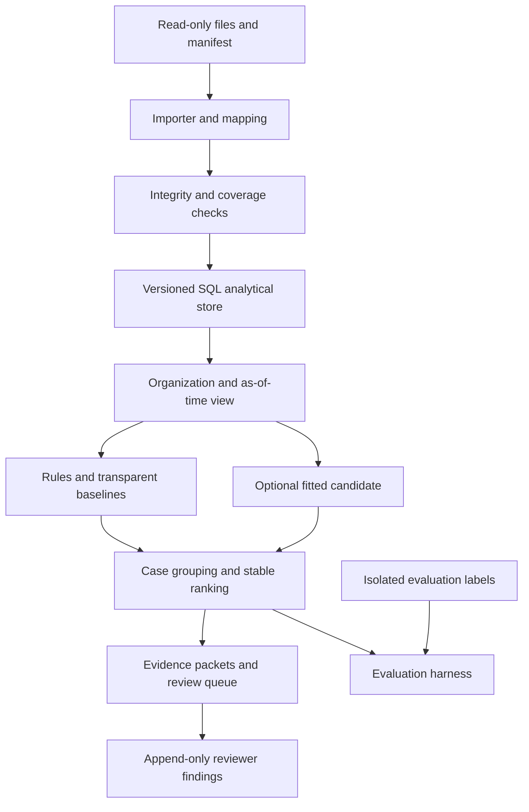

# 02 — Architecture and algorithm contract

**Proposed application architecture.** Only the documentation tooling exists today. Module paths below are implementation targets.

## Runtime shape

Use a Python package and CLI, one local SQL analytical store, and immutable files. Prefer DuckDB for transparent local columnar analysis; pin and test a maintained version when establishing the executable research environment. Store immutable source files outside the repository. Run relational checks and features in SQL with bound parameters. Use scikit-learn pipelines for a simple candidate; do not create a distributed platform before data volume requires it.

A later HTTP review API is optional and can use a maintained Python framework. R1 can produce a local static review report and JSON export without a hosted service. A Go ingestion service is a later measured option, not a mandatory second implementation. Ruby on Rails is a reasonable product-framework choice in other contexts, but adds no advantage to this project's initial algorithm study. Rust is reserved for a demonstrated low-level bottleneck with contract-preserving tests.

## Module contracts

| Planned module | Input | Output | Must not do |
|---|---|---|---|
| `ingest/reader.py` | Allowed files, mapping, organization | Canonical rows and source lineage | Guess financial sign or mutate source |
| `accounting/validation.py` | Canonical entries and manifest | Integrity and coverage diagnostics | Infer fraud from missing/invalid data |
| `temporal/views.py` | Engagement, cutoff, versioned state | Allowed evidence and entries | Reveal later reversals, approvals or labels |
| `features/context.py` | Permitted view, training transform | Feature rows and provenance | Fit on validation/test rows |
| `rules/engine.py` | View, versioned review policy | Typed reasons and candidate IDs | Produce a legal or audit verdict |
| `ranking/baselines.py` | Same case population | Comparable deterministic rankings | Change case eligibility by strategy |
| `ranking/candidate.py` | Frozen feature pipeline | Oriented score and artifact hash | Call a score a fraud probability |
| `cases/grouping.py` | Typed links and candidates | Stable case membership | Merge organizations or unrelated matters |
| `review/packets.py` | Ranked case, permitted evidence | Source-linked report | Invent absent support or implied causality |
| `evaluation/runner.py` | Frozen predictions and private labels | Measured report and run manifest | Leak outcomes into ranking |

## Storage and identity

The planned local tables are `source_import`, `entity`, `engagement_scope`, `account_mapping_version`, `fiscal_period_version`, `journal_entry`, `journal_line`, `evidence_record`, `relationship_record`, `policy_version`, `feature_snapshot`, `rank_run`, `case_member`, `reason_record` and `review_finding`. Separate raw source, normalization and experiment artifacts. A report identifies all relevant source/configuration hashes.

Primary identities are organization-qualified; journal and line keys also include legal entity and source system. An identifier's text is never authority. Preserve both source ID and canonical ID. Model features exclude raw IDs and label-encoding filenames. Entity is useful for scope and split grouping, not as a shortcut to a known synthetic class.

For each import compute SHA-256 over original bytes and preserve extract range, completeness assertions, row count and available control totals. Repeated identity plus same hash returns the previous result. Repeated identity plus different hash requires a distinct source version or an integrity error. A partially parsed file does not become a successful complete import.

## Financial semantics

A line has exactly one positive side and the other side zero. The journal currency and its exponent define all line amounts. The fixture contract caps individual minor-unit amounts at 9,000,000,000,000; totals use checked integer accumulation. Zero-only lines and negative amounts fail canonical validation. Source systems using signed amounts require explicit, reviewed sign mapping rather than a second hidden convention.

Balance is computed per entry. Coverage checks then compare counts and totals with supplied source controls, separately by entity, period and currency. Aggregate gross debits are a control total, not a loss estimate. For reports, a case's financial magnitude is displayed as its documented amount basis (for example, original journal gross debit total); related reversals are not added again as new loss. No amount-weighted detection metric is called “money saved.”

Functional-currency-only R1 is deliberate. A multi-currency ledger requires source currency, functional currency, exchange-rate evidence and rounding policy. Until implemented, mixed-currency cases are rejected or quarantined with an unsupported-input reason. Cross-currency counterpart gaps cannot be measured by comparing raw integer amounts.

## Time and availability

For each record preserve:

- `effective_date`: accounting/economic date in the entity's fiscal calendar;
- `recorded_at`: source system timestamp of recording;
- `available_at`: earliest documented time the study could access the record;
- `observed_as_of`: cutoff chosen for this replay/report.

For an as-of view, use records with `available_at <= observed_as_of` and validate `recorded_at <= available_at`. Backdated effective dates do not bypass availability. An approval first imported in April cannot be used as known in March even if its document says it was signed in March. Preserve source assertions separately from observed access times.

Fiscal period membership follows a versioned entity calendar, not server local time or string prefixes. A close or reopen event is available only after its recorded observation. “After close” is evaluated against the close state known at the relevant observation and whether the entry's recording time was after the close event. Reopen permissions are scoped to entity, period, allowed actor and validity interval.

As-of features use only earlier visible events. Batch scoring within a day must state its convention: R1 uses a common cutoff with prior-record features strictly earlier than the target entry's `recorded_at`; ties do not see each other. Evidence discovered at cutoff may explain a known entry but must be labeled post-entry evidence. Do not mix a retrospective investigation result with a historical real-time detection claim.

## Rules: version 1 development contract

These rules create review reasons. The numbers below are synthetic development policy, not recommended production controls. Configuration is saved with each run and reviewed for the actual engagement.

| Rule | Development definition | Abstain or suppress when |
|---|---|---|
| `period_end_support_gap` | Manual entry affecting a mapped revenue account in the final 3 calendar days of its fiscal period; required supporting evidence absent at cutoff | Account mapping unknown → quality; evidence feed absent → context missing |
| `unexplained_reversal` | Visible reversal explicitly references an original review-relevant adjustment; no available documented recurring reversal schedule explains it | Reversal not yet visible; conflicting identity; authorized recurring schedule |
| `late_post_permission_gap` | Recorded after known close with no available scoped permission required by the configured policy | Close feed unknown; approved reopen/permission covers entry |
| `related_counterpart_gap` | Declared counterpart expected by a configured due time; authorized comparable entity export is complete through due time and counterpart is absent | Incomplete entity/date scope, grace period not expired, currency mismatch or relationship uncertain |
| `grouped_adjustment_review` | At least 3 visible manual entries in 7 days, same declared business-purpose reference, with collective magnitude exceeding the development review threshold of 1,000,000 minor units | Lack of grouping evidence; recorded legitimate installment policy and documentation |
| `unusual_context` | Historical frequency/amount statistics depart from a frozen development threshold | Insufficient prior history → explicit abstention; migration/calendar context unmodeled |

Inputs supporting the baseline policy (evidence feed coverage, counterpart expectation, approval policy and schedule) must be structured records with provenance. Free text alone does not establish those facts. The current small fixtures specify expected semantic behavior but do not implement the rules.

The transparent rule baseline orders grouped cases by number of independent rule families descending, then documented gross debit magnitude descending, then earliest visible entry time, then stable case ID. Raw amount is not evidence of wrongdoing. Record ties and preserve order. Correlated reasons in one family contribute once. A case whose only output is `context_missing` belongs to the context queue; quality failures have their own queue and are never silently treated as routine.

## Candidate algorithm

Implement one simple unsupervised candidate first: Isolation Forest over normalized context features, using a preprocessing pipeline fitted on training only. Example features: log amount, past count of the account pair, prior preparer/account frequency, days from fiscal period end, documented manual/automated origin, visible support presence, and available linked-reversal context. Keep missingness indicators. Exclude individual names, raw IDs, free-text labels, synthetic generator parameters, resolution status and future events.

Fit context encoders on the training organization families. Unknown categories map to explicit unknown buckets. Winsorization bounds, medians and scalers come from training. A new entity with too little comparable history produces `insufficient_history`; it is not assigned high suspicion merely for being new.

A candidate anomaly score is uncalibrated. Record whether larger means more unusual, and freeze a test demonstrating that orientation. Do not show “92% fraud.” Keep random seed and estimator/configuration hashes. Selection, threshold choice and any calibration use only labels whose adjudicated outcomes were available by the declared fit/selection cutoff, with label versions recorded. All choices freeze before held-out scoring. A future supervised method requires sufficient adjudicated labels and its own prospective evaluation; do not manufacture binary truth from whether a user clicked an alert.

The hybrid candidate can combine rule-family priority with an anomaly percentile computed against validation-independent training reference scores. Initial plan: preserve mandatory quality/context routes, then sort eligible review cases by a frozen weighted sum of normalized rule count and candidate percentile, selected only on validation. Report the exact weights in the run manifest. Compare rules-only, model-only and no-link-context ablations on the same cases. If the model loses, ship the better transparent baseline for the research demonstration.

## Grouping and review budget

Build a case from explicit same-organization/entity references, reversal linkage or the predeclared grouping key. Cross-entity links require authorized scope and explicit relationship evidence. Mere equal amount, shared name, same preparer or string similarity is insufficient to merge cases. Avoid giant connected components: log group size and route unusually broad groups to review rather than hiding thousands of entries behind one cheap review slot.

One review budget unit is one case packet with its full member count reported. Also report total underlying entries reviewed and observed reviewer minutes if collected. The full eligible universe is grouped before every strategy ranks it; algorithms may not improve recall by seeing only their own preselected candidates. Quality and context queues have separately reported counts/workloads.

## Explanations and safe presentation

A reason record contains rule ID/version, exact operands and comparison, source entry IDs, supporting evidence IDs, their availability timestamps, known missing evidence, score contribution (if defined), and a neutral question. Example: “This manual revenue adjustment is dated in the final three days of the period. No required support is present in the available evidence feed. Review the revenue support and mapping.”

Model explanations report the features and comparisons actually used. Feature attribution is not proof of a causal mechanism; record this limitation. Test faithfulness by changing an operand, removing supporting evidence and excluding future information, then requiring the reason to change or disappear correctly. Do not generate a fluent unsupported story.

Escape all user text in HTML and CSV exports; prevent spreadsheet formula execution by exporting safe text fields. Rendered content has no active scripts from source documents. There are no network tools available to a document parser or explanation component.

## Resilience and security

R1 runs local and read-only. Input limits, file type allowlists, deterministic parsing, safe paths and explicit schema versions are required. Canonical records are immutable; corrections produce new versions. Keep raw data, identity mappings, trained artifacts and private labels outside Git. Encrypt and restrict authorized real data according to the pilot agreement; the blueprint is not a substitute for its security design.

Failure states are exported with reason codes. A timeout, unsupported currency or missing required file is not a zero-risk result. Each run records eligible, quarantined, abstained, scored and failed counts that reconcile with the admitted population. Report reproducibility drift rather than overwriting prior artifacts.
